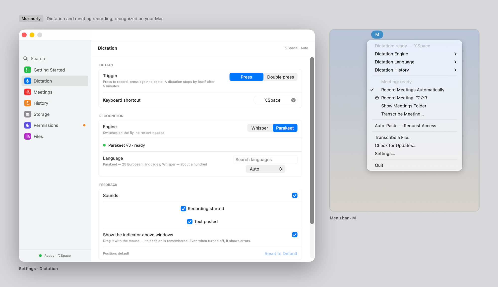

# Murmurly

<picture>
  <source media="(prefers-color-scheme: dark)" srcset="docs/hero-dark.png">
  <source media="(prefers-color-scheme: light)" srcset="docs/hero-light.png">
  
</picture>

Murmurly is a dictation and meeting recorder for your Mac. Speech is recognized
on your Mac: Murmurly never uploads your recordings or text to be transcribed.

- **Dictate into other apps.** Press ⌥Space, speak, press ⌥Space again: the
  text is pasted where your cursor is.
- **Record calls on their own.** When another app starts using the microphone,
  Murmurly records two separate tracks: your microphone, and the sound of the
  call.
- **Get a transcript.** When the call ends, Murmurly transcribes it into a text
  file with timestamps, where your microphone and the call audio are labeled
  separately.

## Features

- Dictation into any text field that accepts pasting, with a keyboard shortcut,
  a double press of ⌘ or ⌥, or while you hold the shortcut down.
- Paste the last dictation again with ⌃⌘V wherever your cursor is now, or copy
  it to the clipboard with ⌃⌘C.
- Esc keeps a dictation's text without pasting it, while it is recording or
  being recognized.
- A personal dictionary entry can be a snippet: say one of its phrases to
  paste a prepared text instead.
- Automatic meeting recording when another app takes the microphone, or manual
  recording with ⌥⇧R.
- Your microphone and the call audio are saved as separate tracks, so the
  transcript can tell them apart.
- Automatic transcription after meetings, on by default.
- Transcribe a meeting again with another engine or language; earlier
  transcripts are kept.
- Transcription of audio and video files: mp3, m4a, wav, mp4, mov.
- Dictation history with search; recognize a saved dictation again.
- A personal dictionary for the names and terms the engine gets wrong, in
  dictation, meetings and files.
- Listen to a meeting from any line of its transcript, and search the
  transcripts of all meetings.
- Put names in place of "Me" and "Others", save a transcript as Markdown, text
  or SRT subtitles, and add a word the engine got wrong to the dictionary
  right from the transcript.
- Two speech engines: Parakeet (25 European languages) and Whisper (about 100
  languages).
- Finished recordings are stored as 24-bit Apple Lossless.
- Optional: move finished meetings to an external drive or a network folder, and
  copy each transcript into your notes folder.
- Delete a meeting's audio or the whole meeting to the Trash, one or several at
  once; optionally, delete the audio of fully transcribed meetings after 7, 30
  or 90 days.
- AI agents such as Claude Code and Codex can read your meeting transcripts and
  dictations, when you allow it, through a read-only `murmurly` command.
- Interface in 12 languages.
- Automatic updates.

## Requirements

- A Mac with Apple silicon.
- macOS 15 Sequoia or later. Tested on macOS 26.
- Free disk space for the speech model: about 0.5 GB for Parakeet or 1.6 GB
  for Whisper, plus room for your recordings.

**How long transcription takes.** One measurement on one Mac (Apple M4, 16 GB,
macOS 26.5): a 97-minute meeting recording, two tracks, was transcribed in
1 min 49 s with Parakeet and in 13 min 2 s with Whisper large-v3 turbo. Other
Macs and recordings will take different times.

**The first start of a model.** Before a downloaded model is first used, macOS
prepares it for your Mac. Murmurly starts this in the background right after
the download and at each launch, for the selected engine. On the same Mac this
took about 15 seconds for Parakeet and about 2 minutes for Whisper large-v3
turbo; later starts take a few seconds at most. After an update, macOS may
prepare the model again. Until it is ready, the menu says so and the first
dictation waits for it.

## Installation

1. Download the latest `.dmg` from the
   [Releases](https://github.com/spacevibes365/Murmurly/releases) page.
2. Open it and, in its window, drag the **Murmurly** icon onto the
   **Applications** icon.
3. Open Murmurly from Applications. The first time, macOS asks whether to open
   an app downloaded from the internet: click **Open**.

**On a standard (non-administrator) account**, copying into Applications asks
for an administrator's name and password. Click **Cancel** and use an
Applications folder in your home folder instead: in Finder, choose **Go →
Home**; if there is no **Applications** folder, choose **File → New Folder**
and name it `Applications`. Drag **Murmurly** from the disk image into it and
open it from there. Murmurly works the same from either folder.

Murmurly lives in the menu bar. It has no Dock icon: one appears only while one
of its windows is open. Choose **Open Murmurly** at the top of the menu, or open
the app again from Finder or Launchpad while it runs, to see your meetings.

### If macOS won't open the app

Murmurly is signed with a Developer ID and notarized by Apple, so macOS only
asks once whether to open it. If macOS refuses to open it instead, make sure
your copy came from the
[Releases](https://github.com/spacevibes365/Murmurly/releases) page, and that
**System Settings → Privacy & Security → Allow applications from** is set to
**App Store & Known Developers**.

Starting with 0.2, official releases are signed with the same Developer ID,
so updates normally keep the permissions you granted. Updating from 0.1, or
from a copy you built yourself, may require granting them again: if recording
or pasting stops working, check **System Settings → Privacy & Security**.

### Updates

Murmurly checks for updates right after its first launch and then once a day,
without asking first, and offers to install a new version with one click.
**Check for Updates…** in the menu checks right away. To turn automatic checks
off, use the **Check automatically** switch in **Settings → Permissions →
Updates**; your version of Murmurly is shown there too.

A check downloads the list of releases (`appcast.xml`) from GitHub; installing
downloads the new version from there too. Murmurly does not send a profile of
your Mac (the optional system profile of Sparkle, the update library, is off).
As with any download, GitHub sees your IP address and the request's standard
headers, which name Murmurly, its version and the version of Sparkle. Your
recordings, dictations and transcripts are never part of an update. Updates are
signed, and Murmurly refuses one whose signature does not match.

**Installing during work.** If you choose **Install and Relaunch** while a
meeting is being recorded or transcribed (its transcript copy included), a
dictation is running, a file is being transcribed in **Files**, a meeting's
name, star or speakers' names are not saved yet, or a transcript is being
written with **Save As**, Murmurly does not restart. The update window closes, and the menu and
**Settings → Permissions → Updates** say "The update will be installed when you
quit the app". It is installed the next time you quit Murmurly, or you can
choose **Check for Updates…** again when the work is done and pick **Install and
Relaunch** or **Install on Quit**. If **Files** holds text you have not saved,
the quit that would install the update stops with the usual warning, and the
menu says the same; save the text, then quit.

## Getting started

On the first launch Murmurly opens a **Getting Started** screen with five
numbered steps. The model step is checked once the model is ready, and each
permission shows whether it is granted:

1. **Download a speech model.** Parakeet (about 0.5 GB) is the default and
   covers 25 European languages. Whisper (about 1.6 GB) is for other languages.
   You can switch engines at any time in **Settings → Dictation**; each engine
   needs its own model. A small speech-detection model (1 MB) comes along with
   either one.
2. **Permissions.**
   - **Microphone.** Without it, neither dictation nor meeting recording works.
   - **Accessibility (optional).** Murmurly needs it to paste the text into the
     app you are typing in. Without it, the text stays on the clipboard and you
     paste it with ⌘V. On the first launch Murmurly does not ask on its own;
     click **Grant…** when you want it.
   - **System audio recording.** Recording the other side of a call needs a
     macOS permission, which macOS asks for at the first meeting recording.
     **Check…** only shows that Murmurly can create an audio source; it does not
     confirm the permission.
3. **Try dictation.** The screen shows the shortcut or double press you set.
4. **Automatic recording** of meetings is on. Read what it records (see below),
   and turn it off right there if you don't want it.
5. **Startup:** Open at login is on. On the first launch Murmurly adds itself
   to the login items, and macOS shows a “Login Item Added” notification. Turn
   it off right there or in **Settings → Permissions**.

Models download from Hugging Face only when you ask. The first time a model is
used, macOS prepares it for your Mac, which takes a while. If that fails,
**Settings → Dictation** and the menu say so; **Try Again** prepares it again,
and if it keeps failing, move the model folder (**Show in Finder**) to the
Trash and download the model again.

Updates normally keep the permissions you granted; updating from 0.1 or from a
copy you built yourself may not (see
[If macOS won't open the app](#if-macos-wont-open-the-app)). If Accessibility
is missing after an update, Murmurly asks for it once, at the first launch of
the new version.

Murmurly starts when you log in. You can turn that off in **Settings →
Permissions**.

## Dictation

- Press **⌥Space**, speak, and press **⌥Space** again. The text is pasted into
  the app that was in front. Murmurly then puts back what was on your clipboard,
  unless you copied something else in the meantime; this happens only on this
  Mac, so something you copy on another device is not undone by it.
- Nothing is pasted or put on the clipboard in a field macOS itself marks as a
  password field; a notice says where the text is instead.
- Turn off **Paste automatically** in **Settings → Dictation → Pasting** to
  keep dictations out of your clipboard and out of other apps: they go to
  **Dictations** only, and you paste the last one with **Paste last
  dictation** (⌃⌘V by default) or copy it with **Copy last dictation** (⌃⌘C).
  Both work whether or not **Paste automatically** is on.
- Press Esc to cancel a dictation before the microphone has started. While it
  is recording or being recognized, Esc stops it and saves it to
  **Dictations** without pasting it; a notice names the shortcut to paste it
  afterward.
- If the text does not appear (the field does not accept pasting), it is in
  the history and, with **Paste automatically** off, only in **Dictations**;
  otherwise it is also on the clipboard.
- One dictation can last up to 5 minutes; the last 30 seconds are counted down
  on the recording indicator. At the limit the recording stops, what you said
  is recognized and pasted, and Murmurly says it stopped at the 5-minute limit;
  start a new dictation to go on.
- Dictation is not available while a meeting is being recorded, and a meeting
  recording does not start during a dictation: both need the microphone.
- To change the shortcut, open **Settings → Dictation**. **Trigger** chooses
  how it starts: **Press** it to start and press it again to stop, **Hold**
  it while you speak and release it to paste (releasing it in under half a
  second drops the recording instead), or **Double press** the left or right
  ⌘ or ⌥ key and stop with a single press. Double press needs Accessibility;
  until it is granted, only the backup shortcut works, if you set one, and
  Settings says so.
- Choose the language in the menu (**Dictation Language**: Auto, the current
  language, **More Languages…**) or in **Settings → Dictation**, where you can
  search the list. **Auto** lets the engine decide.
- The text of each recognized dictation is saved to the history
  (**Dictations** in the Murmurly window; **Open Full History…** in the menu
  opens it), where you can search it. **Clear history** (the trash button
  above the list) deletes all dictations and their audio.

### Dictation audio

By default Murmurly keeps the text of your dictations, but not the audio. To
keep the audio too, turn on **Save dictation audio** in **Settings → Dictation**.

Even with this switch off, Murmurly tries to keep the audio when recognition fails,
when the recording is cut off, or when you quit during a dictation. A dictation
that could not be recognized appears in the history as "— not recognized —"
with its audio, so you can listen to it or transcribe it again: **Show in
Finder** (the folder button in its row) shows the audio file, which you can drop
into **Files** in the Murmurly window. Nothing is pasted in that case.
**Recognize Again**, in a row's menu (Control-click), recognizes the saved
audio again with the current engine, language and dictionary.

If the history itself cannot be written, the dictation stays under **Unsaved
Dictations** in the menu until you quit: a recognized one with its text, which
is still pasted, an unrecognized one with its audio.

## Meeting recording

**When it records.** Recording starts on its own when another app starts using
the microphone: a call in Zoom, Google Meet, Telegram or a browser. Any app that
takes the microphone counts, including a voice message or another dictation app.
System Settings is the exception: checking your microphone in **System Settings
→ Sound** does not start a recording.

**When it stops.** An automatic recording stops 30 seconds after no app (other
than excluded ones) is using the microphone any more, when the Mac goes to
sleep, or after 4 hours. At the 4-hour limit the recording is saved, and the
menu says it stopped at the limit; start a new recording to go on. **Settings →
Meetings** explains these limits too.

**What it records.** Your microphone, and all sound your Mac plays — not only
the call app.

**Manual recording.** Press **⌥⇧R** or choose **Record Meeting** in the menu.
A recording you started yourself has no time limit and does not stop when the
call ends: it stops when you stop it or when the Mac goes to sleep. You can
change the shortcut in **Settings → Meetings**.

> **Consent.** In many countries, recording a conversation requires the consent
> of everyone in it. Murmurly does not notify other participants. Obtain any
> required consent before you turn on automatic recording or join a call.
>
> To turn automatic recording off, use the switch in the menu or in
> **Settings → Meetings**.

**System audio permission.** macOS asks for permission to record system audio
the first time Murmurly records a meeting. The recording starts only after you
allow it: nothing is recorded while the request is on screen. If a recording
fails (for example, because this permission was denied), the menu says why and
what to do: check **Settings → Permissions**, then choose **Record Meeting** to
record the current call. Murmurly does not retry on its own for an app whose
recording failed.

**Excluding an app.** While an app is being recorded, the menu offers **Exclude
<app> from Auto-Recording**; the list of excluded apps is in **Settings →
Meetings**. Excluding an app keeps it from starting future recordings, and can
stop the current automatic recording if no other app needs the microphone. It
does not filter that app's sound out of other recordings, because system audio
is recorded as a whole.

### Where recordings are kept

By default each meeting is a folder in
`~/Library/Application Support/Murmurly/Meetings/`, named by date and time:

| File | What it is |
|---|---|
| `microphone.m4a` (or `.caf`) | Your microphone |
| `system.m4a` (or `.caf`) | Everything your Mac played: the call |
| `transcript.md` | The transcript, when speech was recognized and transcription finished. Check it for warnings about missing parts. |
| `metadata.json` | Technical details of the recording |
| `murmurly.json` | The meeting's star, your own name for it and the speakers' names |
| `.attempt 0001 ….murmurly.json` (hidden) | What became of each transcription attempt: whether its transcript is complete, the engine and language. Leave them in the folder |

Tracks are written as `.caf` during the call. Finished tracks are stored as
24-bit Apple Lossless (`.m4a`); if compression cannot be completed safely, the
original `.caf` is kept.

**Show Last Recording…** in the menu opens the latest recording in the Murmurly
window, and **Show Meetings Folder** opens the folder with all of them in
Finder: the one you chose in **Settings → Storage**, or, if it is not available
right now, Storage settings, so you can see why.

In **Settings → Storage** you can have finished meetings moved to another
folder, such as an external drive or a network share, and have each new
transcript copied into a folder of your choice, such as your notes app's
folder. The copy is named after the meeting, for example
`2026-10-09 14-30-00 Meeting.md`, whatever the interface language. Neither
folder can be the dictations folder or a folder inside it. **Show in Finder**
next to each chosen folder shows it, when Murmurly last found it available; it
checks again when you come back to Murmurly or connect or eject a disk.
Recording itself always happens on your Mac. While the other folder
is not available, meetings wait on your Mac and Storage says why; they move by
themselves at launch, when a disk is connected and after each recording, and
**Move Now** tries right away.

### The Murmurly window

**Open Murmurly** in the menu shows your meetings: those on this Mac and those
in the meetings folder you chose in **Settings → Storage**, newest first, under
Today, Yesterday, This Week and then by month. Each row shows when the meeting
started, how long it lasted, which app started the recording (or "Manual"), how
its transcription stands and its size. Meetings shorter than a minute are
faded; a recording that broke off before it was saved (the app or the Mac
stopped) says so, and the recording under way has its own row with a **Stop**
button.

A meeting's row shows **Fully transcribed** with a check mark only when Murmurly
recorded that its transcription missed nothing; a transcript made before
Murmurly kept such records says **completeness unknown**, and one with gaps or
cut short shows a warning.

The sidebar also holds **Dictations**, the dictation history, **Dictionary**,
your personal dictionary, and **Files**, for transcribing a file; **Settings…**
at its bottom opens the settings, and the button at the top of the window folds
the sidebar away.

Click the star of a meeting to find it under **Starred**, and click the pencil
next to its title to give it a name of your own (press Return to save; an
empty name shows the date again). Both are kept in the meeting's folder, in
`murmurly.json`, so they go wherever the meeting goes; the folder itself is
never renamed. A name is also saved when you click elsewhere or choose another
meeting; Esc drops it. While a meeting is being moved to your meetings folder,
its star and name cannot be changed; on a network share, quitting before they
are saved asks first.

Select a meeting to read its transcript. Select text across lines and copy it,
press **⌘F** to search it, or use **Copy Text**. A meeting transcribed more than
once keeps every transcript; choose one above the text. **Transcribe** makes the
first transcript as your settings say; **Transcribe Again…** lets you pick the
engine and language for this transcription only. The card also shows what went
wrong: a recording saved with a warning, a transcript cut short or with gaps,
a transcription that failed, and other files you put in the meeting's folder.
**Show in Finder** shows the folder.

The button with two people next to the star names the speakers: who speaks into
your microphone, and who is heard from the call. The names take the place of
"Me" and "Others" in the window, in **Copy Text** and in files you save, with a
line under the header saying who is who; the transcript files themselves never
change, and a new transcription keeps the names. They need the record Murmurly
keeps of which track each line came from, so a transcript changed by hand or
made before such records shows its own labels and says why. **Save As** saves
the transcript shown as Markdown, plain text or SRT subtitles (subtitles need
the same record, for each line's exact start and end), named after the
meeting, for example `2026-10-15 10-31 Meeting.md`; never into a meeting's own
folder. Select the words the engine got wrong and click **Add to Dictionary…**
(or Control-click them) to make a dictionary entry from them.

Below the transcript, a player plays the meeting's audio: both tracks
together, 15 seconds back or on, at 0.75× to 2×, with your side (Me, or the
name you gave) or the others muted if you like. Click a line's time to hear it from there; the line
being said is highlighted, and Space plays and pauses while the card has the
focus. Line times are exact while the transcript is the one Murmurly wrote;
for a transcript changed by hand or made before Murmurly kept its records,
they come from the timestamps in the text and are approximate. The player
pauses when a dictation starts and stops when a meeting recording starts,
since the recording takes all the sound the Mac plays; it closes the audio
before the meeting is moved or deleted.

**Search All Meetings** above the list searches the meetings' names and their
newest transcripts (not the timestamps, the speaker labels or the header).
The list keeps the meetings found, each with how many times; the transcript
shows every match, and above it which one of how many is selected, with arrows
to the previous and next. Return goes to the first, **⌘G** and **⇧⌘G** to the
next and previous. Upper and lower case and the Russian ё and е are not told apart.
A transcript not read yet, one that cannot be read, or a meetings folder that
is not available is said above the list, never taken for "no match".

The window reads the meetings folders when it opens, when you come back to
Murmurly, when a disk is connected or ejected, after each recording and
transcription, and when you click **Refresh** (**⌘R**). A meetings folder on a
network share that does not answer is said to be not responding; the meetings
on this Mac are shown meanwhile. "Show Transcript" and "Show Last Recording…"
in the menu open their meeting in the window, even one in a folder you chose
earlier.

### Deleting meetings and their audio

**Delete Audio…** removes a meeting's tracks and keeps its transcripts, name
and star; **Delete Meeting…** removes its whole folder. Find both in the
meeting's card under **Delete**, in a row's menu (Control-click), or, with
several meetings selected (⌘-click or Shift-click), on the card that appears;
**⌘⌫** in the list deletes the selected meetings. Murmurly first says how much
goes, names any other files in the folders, and lists what cannot go now and
why (a meeting being recorded, transcribed or moved, for example). Everything
goes to the **Trash**, so you can put it back from there. If something changed
in a folder after you confirmed, Murmurly asks again instead. A folder on a disk
without a Trash, such as some network shares, is not deleted: Murmurly shows it
in Finder for you to delete. Copies of transcripts in your transcripts folder
are never touched.

**Meeting audio** in **Settings → Meetings** can delete a meeting's audio 7, 30
or 90 days after its first full transcription (the default keeps it). Before
the setting changes, Murmurly says how many meetings lose their audio right
away. This deletion is for good, not to the Trash, and only for a meeting whose
last transcription missed nothing, whose transcript is unchanged since, which is
not starred and whose recording was saved without a warning; anything else
keeps its audio, and the meeting's card says why. **Settings → Storage** shows
how much meeting audio there is and how many meetings have none left.

### Transcripts

After a meeting, Murmurly transcribes it automatically (you can turn this off
in **Settings → Meetings**). `transcript.md` is plain text with timestamps. It
labels speech by where it was recorded, not by who spoke:

- **Me** — what your microphone heard;
- **Others** — what came through system audio.

Murmurly does not tell the other participants' voices apart: everyone on the
other side is "Others".

If you use speakers instead of headphones, your microphone also hears the other
side. Murmurly tries to remove this duplicated speech from the microphone's part
of the transcript; the recorded audio is not changed.

**Keep Murmurly running until the transcription finishes.** A transcription
that quitting interrupts does not resume on its own, and a meeting that was
still recording when you quit is saved but not transcribed. So when you quit
during a meeting transcription, while a finished transcript is being copied to
your transcript folder (**Settings → Storage**; that copy is not made again
later), or while recording a meeting that would be transcribed afterwards,
Murmurly stays open and says what would be lost; quit again within 10 seconds
to quit anyway. Logging out, restarting or shutting down the Mac does not wait
for this. To transcribe such a meeting later, choose **Transcribe Meeting…** in
the menu and pick the meeting's folder; a stopped copy is not redone, but the
transcript stays in the meeting folder.

If no model is downloaded yet, the recording is still saved. Download a model,
then use **Transcribe Meeting…** the same way.

**Transcribing a meeting again.** Below the folders, the **Transcribe
Meeting…** panel has **Engine** and **Language** for this transcription only;
your settings stay as they are. An engine whose model is not downloaded is
marked so, with a button that downloads it. **Transcribe Again…**, next to the
last transcription's result in the menu, opens the panel inside that meeting's
folder, wherever it is now. Each new transcript is saved in a separate file
(`transcript 2.md`, `transcript 3.md` and so on, and, if you chose a
transcripts folder, a copy such as `2026-10-09 14-30-00 Meeting 2.md` there);
earlier transcripts are kept.

## Transcribing files

Choose **Transcribe a File…** in the menu (it opens the Murmurly window on
**Files**) and drop in an audio or video file (mp3, m4a, wav, mp4, mov), or
click **Choose File…** or the drop area to choose one, then **Transcribe**.
Murmurly uses the same engine and language as for dictation unless you pick
others in the menu above the text, for every run until **As Dictation**, shows
each step (the first preparation of a model can take a couple of minutes), and
then the text with timestamps. To transcribe another file, drop it onto the
text or choose it again. If the engine picked in that menu has no model yet, a
button under the menu downloads it.

The result is not added to the dictation history or saved automatically. It is
kept in the app until you quit, as the note under the text reminds you; save
it as a `.md` file to keep it. Copying it does not count as saving. Closing the
window neither stops a transcription nor loses its text; open **Files** again
to find it. Before a new file or a new run replaces text you have not saved,
Murmurly asks: **Save .md…**, **Replace** or **Cancel**. Cancelling a
transcription in progress discards what it had recognized so far.

Quitting while a file is being transcribed, or while **Files** holds text you
have not saved, warns first; quit again within 10 seconds to quit anyway.
Logging out, restarting or shutting down the Mac does not wait for this.

If parts of a file cannot be recognized, or a recognition error stops the
transcription partway, the text recognized so far is kept, with a note at the
top that says what is missing. If nothing was recognized yet, you see the error
instead. Transcription never writes beside the input file; you choose where to
save the `.md`.

## Personal dictionary

The engine may write a name or a term the wrong way, for example "mur merly"
for "Murmurly". To fix it, open **Dictionary** in the Murmurly window and
click **Add…**: under **Heard as**, list the spellings the engine writes,
separated by commas; under **Write as**, how you want it written. **Try it**
shows a sentence of yours with the dictionary applied. Each entry has its own
switch, and **Where it applies** turns the dictionary on or off for dictation,
meetings and files.

To make an entry from a dictation, Control-click it in **Dictations** and
choose **Add to Dictionary…**, then select the words the engine got wrong in
the text as it was recognized and click **Use Selection**. From a meeting's
transcript, see [The Murmurly window](#the-murmurly-window).

An entry can also be a **Snippet**: choose **Kind → Snippet** when you add it,
list the phrases to say under **Say**, and the text to paste under **Text**,
line breaks included. Say one of the phrases, and nothing else, for the whole
dictation to paste that text instead of what was recognized; said inside a
longer dictation, it does nothing. Snippets apply to dictation only, not to
meetings or files.

The dictionary applies to new dictations, meeting transcripts and file
transcripts; what is already saved does not change. Upper and lower case and
the Russian ё and е are not told apart. With the language set to Auto or
Russian, a spelling in Cyrillic letters for a word written in Latin ones also
matches the other forms of that word that macOS knows; add the forms it
misses, often of English terms, as more spellings. A form may also match a
similar word.

**Export…** saves the dictionary to a file, and **Import…** reads one, for
example on another Mac: **Add to My Dictionary** keeps your entries and adds
the file's new ones, and **Replace My Dictionary** takes the file's entries as
they are.

## Languages

**Interface.** English, Russian, Spanish, German, French, Portuguese (Brazil),
Italian, Ukrainian, Polish, Chinese (Simplified), Japanese and Korean. English
is the original, and the Russian translation has been checked by a native
speaker. The other ten are machine translations that no native speaker has
checked yet; if you can help, see [Contributing](#contributing). Murmurly
follows the language of macOS. To use a different language for Murmurly alone,
open **System Settings → General → Language & Region → Applications**.

**Speech recognition.**

- **Parakeet** (default): 25 European languages — Bulgarian, Croatian, Czech,
  Danish, Dutch, English, Estonian, Finnish, French, German, Greek, Hungarian,
  Italian, Latvian, Lithuanian, Maltese, Polish, Portuguese, Romanian, Russian,
  Slovak, Slovenian, Spanish, Swedish and Ukrainian.
- **Whisper**: about 100 languages.

With **Auto**, the engine decides. In meetings and files, Whisper uses Auto
until the first successfully recognized stretch of speech longer than 5 seconds,
then keeps that language for the rest of the transcription. "First" means
processing order: for a meeting, the microphone track is processed before the
system audio track. Until then, shorter stretches still get transcribed on Auto;
if no such long stretch is found, Auto is used throughout. This does not detect
language changes during a conversation. If you always speak one language,
choosing it explicitly gives the most reliable result.

With Parakeet, choosing a language also limits the alphabet. With **Russian**,
for example, English words and names come out in Cyrillic. **Auto** has no such
limit, so a mixed conversation keeps English terms in Latin letters, but a few
short replies may come out in the wrong alphabet.

If you switch to an engine that does not know the language you chose, it uses
Auto; your choice is kept for the other engine, and **Settings → Dictation**
says so under the language list.

## Use with AI agents

An AI agent such as Claude Code or Codex can read your meeting transcripts and
dictations through Murmurly, so you can ask it what was decided in yesterday's
call or find something you dictated last week. It only reads: nothing in
Murmurly is changed, and no audio is shared.

**Allow it first.** Open **Settings → Agents** and turn on **Meetings**
(transcripts and meeting titles), **Dictations** (dictation text, without
audio), or both; under **Period**, choose how far back an agent may look. Both
switches are off until you turn them on, and the agent is told "access is off"
until then.

**Connect.** Under **Connect**, click **Connect to Claude Code** or **Connect to
Codex**. Murmurly finds the program in its usual install places and adds itself
to that program's settings; start a new session of the agent afterwards. This
works only for a copy of Murmurly in the Applications folder, as the agent is
pointed at that copy. If you move Murmurly, the row says the connection is
out of date: click **Update Connection**. If the program is not
found, **Copy Command** gives you the command to run in Terminal yourself.

**Command in Terminal.** **Install Command in Terminal** asks for an
administrator password once and puts a `murmurly` command into
`/usr/local/bin`, so it works in any new terminal window:

```sh
murmurly meetings                 # the latest meetings, newest first
murmurly transcript <id>          # one meeting's transcript, in chunks
murmurly search "budget"          # meetings and dictations
murmurly dictations --last 20
```

Add `--json` for the answer as JSON, and run `murmurly` alone for every option.

**What an agent gets.** Answers come in portions so they do not fill the
agent's memory: 50 meetings, 200 transcript lines, 20 search results from
each of meetings and dictations, or 20 dictations at a time. The agent asks for the next meetings or the next lines of
a transcript itself, and narrows a search or the dictations by date. Each
answer is what is on disk at that moment. Every request is written, without
its text, to `~/Library/Logs/Murmurly/agents.log`.

**Privacy.** Murmurly does not send your meetings or dictations anywhere. An
agent you allow sends what it reads to its own cloud model, under that
company's terms. The switches are your consent, not a lock: any program
running under your account can read the files directly.

## Privacy

- Speech is recognized on your Mac. Murmurly does not upload recordings or text
  to be transcribed. There are no accounts and no analytics.
- Murmurly itself goes online only for two things: to download a model from
  Hugging Face when you ask, and to check GitHub for updates once a day and
  download them. The update check is on by default and can be turned off; see
  [Updates](#updates) for what it reveals.
- Your files go only where you put them. Murmurly keeps them in these default
  locations on your Mac:
  - dictations: `~/Library/Application Support/Murmurly/Dictations/`
    (the history is a plain `history.jsonl` file, one dictation per line);
  - meetings: `~/Library/Application Support/Murmurly/Meetings/`;
  - models: `~/Library/Application Support/Murmurly/Models/`.

  If you choose a network or cloud-synced folder for meetings or transcript
  copies in **Settings → Storage**, recordings and transcripts go there too.
- Automatic pasting and the clipboard fallback use a clipboard restricted to
  this Mac. Once pasted, text is handled by the destination app, which may sync
  or send it. Text you copy yourself with a **Copy** button uses the regular
  clipboard, which macOS may share with your other devices through Universal
  Clipboard.
- AI agents read nothing until you turn it on in **Settings → Agents**; an agent
  you allow sends what it reads to its own cloud model. See
  [Use with AI agents](#use-with-ai-agents).
- The log (`~/Library/Logs/Murmurly/`, also **Show Log in Finder** in **Settings
  → Permissions**) contains file names and folder paths. Check it before you
  attach it to a bug report.

## Known limitations

- The other participants' voices are not told apart: everyone on the other side
  is "Others".
- Removing duplicated speech does not work for languages written without spaces
  between words, such as Chinese and Japanese.
- The personal dictionary finds other forms of a word only in Russian, and only
  for words macOS knows; add the forms you need as more spellings. It does not
  support languages written without spaces between words, such as Chinese and
  Japanese.
- Dictation and meeting recording never run at the same time.
- One dictation lasts at most 5 minutes; an automatic meeting recording at most
  4 hours.
- A meeting transcription that was interrupted by quitting does not resume on
  its own; start it again with **Transcribe Meeting…**. Logging out, restarting
  or shutting down the Mac interrupts it without a warning.
- File transcripts are kept only until you quit Murmurly (it warns about
  unsaved text when you choose Quit); save them as `.md`.
- A meeting records the microphone that was the default when it started.
  Switching audio devices during a recording (for example, putting on AirPods)
  is not followed. A dictation cut off by such a switch is saved to the history
  but not pasted; paste it afterward with ⌃⌘V.
- Esc is a global shortcut and does not reach the app where macOS turns on
  Secure Keyboard Entry (for example, Terminal with that setting on, or some
  password managers), so it does not cancel a dictation there.
- The clipboard after a dictation is restored on this Mac only, so something
  you copied on this Mac beforehand may not reach your other devices
  afterward; this keeps a dictation from overwriting what you copied on
  another device.
- A personal dictionary with a snippet is saved in a format Murmurly 0.2 does
  not apply; clear the dictionary before going back to 0.2.
- If a meeting's microphone drops out for a moment, as Bluetooth headsets
  sometimes do, that moment is left out of both tracks so they stay in step.
  The recording is saved with a warning that says about how many seconds are
  missing, and is transcribed as usual. If the microphone disconnects and does
  not come back, nothing more is recorded, not even the system audio, until
  the recording stops, although Murmurly still shows it as recording. It is
  saved with a warning that gives the time the microphone dropped out, and
  what was recorded before that is transcribed as usual. If another device
  takes the headset over (for example, the same AirPods connect to another
  Mac), the microphone may send only silence instead; the recording is then
  saved with a warning that says how long the silence lasted and when.
- ⌥Space is also the default shortcut of ChatGPT for Mac. If you use both,
  change one of them (**Settings → Dictation**).
- Excluding an app from automatic recording does not remove its sound from
  recordings started by another app.
- Excluding an app stops the current recording at once only when no other app
  holds the microphone. If one does, the recording either goes on for that app
  or stops about 30 seconds later.
- In browsers, the microphone belongs to a helper process shared by all tabs
  (for example `com.apple.WebKit.GPU` for Safari, or a Chrome helper). The menu
  may show that helper instead of the browser's name, and excluding it excludes
  every call in that browser.
- Murmurly 0.1 was not signed with a Developer ID: updating from it may require
  granting the permissions again.

## Building from source

You need a Mac with Apple silicon, the full Xcode 26 or later (not only the
Command Line Tools; Xcode 26 itself needs macOS 15.6 or later) and
[XcodeGen](https://github.com/yonaskolb/XcodeGen) (`brew install xcodegen`).

```sh
git clone https://github.com/spacevibes365/Murmurly.git
cd Murmurly
xcodegen generate
open Murmurly.xcodeproj
```

The Xcode project is generated from `project.yml` and is not stored in git. Run
`xcodegen generate` again after changing `project.yml` or adding files.

**Signing.** A fresh clone signs ad-hoc, so it builds for anyone. The catch:
macOS ties permissions to the exact build, so you may need to grant them again
after every rebuild. To keep them, create a code signing certificate in your
login keychain (Keychain Access → Certificate Assistant → Create a
Certificate…, type "Code Signing") and name it in a `Local.xcconfig` next to
`Signing.xcconfig` (git ignores it):

```
MURMURLY_CODE_SIGN_IDENTITY = My Code Signing Certificate
```

Without an Apple Team ID, Accessibility may still need to be turned on again
after a rebuild.

**Updates in your own build.** `Signing.xcconfig` also holds three update
settings: the feed address (`MURMURLY_SU_FEED_URL`), the download address
(`MURMURLY_SU_DOWNLOAD_BASE`) and the public key that updates must be signed
with (`MURMURLY_SU_PUBLIC_KEY`). With an empty key, the updater does not
start. If you publish your own builds, set all three to your own values;
otherwise your builds would offer the official Murmurly releases as updates.
`scripts/release.sh` explains how to create a key. To keep updates off in a
build for yourself, put an empty `MURMURLY_SU_PUBLIC_KEY =` into
`Local.xcconfig`.

**Tests.**

```sh
xcodebuild -project Murmurly.xcodeproj -scheme Murmurly \
  -destination 'platform=macOS,arch=arm64' -only-testing:MurmurlyTests test
```

Without `-only-testing` the UI tests run too. The separate `MurmurlyStageGate`
scheme runs the app as shipped, with real models, the real microphone and system
audio and real global shortcuts. It is not part of the regular run; its
real-audio tests also need downloaded models and audio files that are not in the
repository.

**Scripts.**

- `scripts/install.sh` builds a Release copy and installs it into
  `~/Applications`, replacing the previous copy after it has quit. It refuses to
  run if a copy is already installed in `/Applications`.
- `scripts/release.sh` builds the DMG. Without arguments it is ad-hoc signed and
  named `…-unsigned.dmg`. With `DEVELOPER_ID` and `NOTARY_PROFILE` set, it is
  signed, notarized and stapled, and any failure stops the release. It also
  writes the signed `appcast.xml` to publish next to the DMG, but only when the
  build has a public update key, the matching private key is available and
  Sparkle's tools were fetched; then it prints `Appcast ready`. Otherwise it
  prints `No appcast` and the reason, and the DMG alone is ready: check for
  `Appcast ready` before you publish an update.

**Build settings.** Swift 6 with strict concurrency checking, and warnings are
errors: a build with any warning in the project's code fails. App Sandbox is
off: the system audio tap and pasting into other apps need a design of their own
before it can be turned on.

### How it works

- A menu bar app with two recording modes that never run at once: dictation and
  meetings.
- Meetings use a Core Audio process tap for system audio, with the microphone in
  the same device, so both tracks run on one clock.
- Automatic recording watches which processes use audio input. Watching needs no
  permission; recording itself still needs the microphone and system audio
  permissions.
- Speech recognition: [FluidAudio](https://github.com/FluidInference/FluidAudio)
  runs Parakeet and the speech detector, [WhisperKit](https://github.com/argmaxinc/argmax-oss-swift)
  runs Whisper. Both work offline; models are downloaded by the app's own small
  downloader, pinned to exact revisions and checked after download.

More detail for contributors is in [CLAUDE.md](CLAUDE.md).

## Contributing

Bug reports and pull requests are welcome. For a bug, use the bug report
template: it asks for your macOS version, Mac model, app version, the speech
engine, and the relevant part of the log with personal names and paths removed.
Before opening a pull request, run the unit tests and make sure the build has no
warnings. Code comments are in English and explain *why*, not *what*.

**Translations.** Interface translations live in
`Resources/Localizable.xcstrings` (and `Resources/InfoPlist.xcstrings` for the
permission prompts) and can be edited in Xcode. The machine translations are
marked *Needs Review*. If you are a native speaker, correct the strings of your
language and mark them as reviewed; a pull request for one language is welcome.

## Security

Please do not report security issues in public issues. Report them privately
through GitHub: the repository's **Security** tab → **Report a vulnerability**.

## License

Murmurly is released under the [MIT License](LICENSE). Copyright © 2026 Denis
Andryushin.

The speech models are not part of Murmurly. They are downloaded from Hugging
Face and keep their own licenses; see
[THIRD_PARTY_NOTICES.md](THIRD_PARTY_NOTICES.md).

## Acknowledgements

Murmurly is built on the work of others:

- [WhisperKit](https://github.com/argmaxinc/argmax-oss-swift) by Argmax
- [FluidAudio](https://github.com/FluidInference/FluidAudio) by FluidInference
- [Parakeet TDT 0.6B v3](https://huggingface.co/nvidia/parakeet-tdt-0.6b-v3) by
  NVIDIA, licensed under CC BY 4.0
- [Whisper](https://github.com/openai/whisper) by OpenAI
- [Silero VAD](https://github.com/snakers4/silero-vad) by the Silero Team
- [KeyboardShortcuts](https://github.com/sindresorhus/KeyboardShortcuts) by Sindre
  Sorhus
- [Sparkle](https://sparkle-project.org)

Full license texts and attributions are in
[THIRD_PARTY_NOTICES.md](THIRD_PARTY_NOTICES.md).
